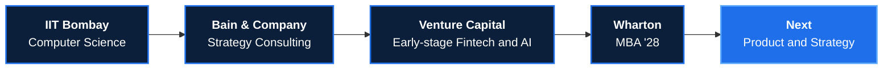

MBA, The Wharton School '28 &nbsp;|&nbsp; B.Tech Computer Science, IIT Bombay &nbsp;|&nbsp; Ex-Bain &amp; Company

---

## The path so far

I learned to build at **IIT Bombay**, learned to solve business problems at **Bain**, and learned to spot what is worth building while evaluating and supporting founders at an **early-stage fintech and AI fund**.

Good technology without a real problem goes nowhere. A real problem without strong execution stays unsolved. I work where the two meet, and I am looking for roles at the intersection of **product and strategy**.

---

## Featured Projects

<table>
<tr>
<td width="50%" valign="top">

#### [Fundraising Chatbot](https://github.com/arpitsingh02/Fundraise-chatbot-public)
**Your data room, now answering back.**

A lightweight chatbot that answers investor questions directly from a shared data room, so founders spend less time on repetitive diligence questions and investors get answers right away.

AI &nbsp;·&nbsp; Fundraising &nbsp;·&nbsp; Document Q&amp;A

</td>
<td width="50%" valign="top">

#### [AI Pulse Check](https://github.com/arpitsingh02/AI-Pulse-Check)
**The news that matters, in 15 seconds.**

A local-first reader for fintech, deep tech AI, and innovation. It pulls from TechCrunch, VentureBeat, Hacker News, and Engadget, ranks what matters, and condenses articles into short briefs entirely on-device. No backend, no paid APIs.

React &nbsp;·&nbsp; Vite &nbsp;·&nbsp; Capacitor &nbsp;·&nbsp; Android

</td>
</tr>
<tr>
<td width="50%" valign="top">

#### [ASR Cocktail Party](https://github.com/arpitsingh02/ASR-CocktailParty)
**Hearing one voice in a crowded room.**

Deep learning for the classic cocktail party problem: using audio-visual cues from video to isolate one speaker's voice from background noise and crosstalk, such as overlapping speakers in a debate.

Deep Learning &nbsp;·&nbsp; Audio-Visual &nbsp;·&nbsp; Speech Separation

</td>
<td width="50%" valign="top">

#### [Wardrobe](https://github.com/arpitsingh02/wardrobe)
**Campus commerce, built in-house.**

An internal e-commerce platform built for the IIT Bombay community.

Web &nbsp;·&nbsp; E-commerce

</td>
</tr>
</table>

---

## Built at IIT Bombay

As part of the Undergraduate Academic Council (UGAC), I built and maintained student-facing platforms used across campus.

<table>
<tr>
<td align="center" width="50%"><h2>1,000+</h2>monthly active users on Creddit</td>
<td align="center" width="50%"><h2>6</h2>campus platforms shipped, including Wardrobe</td>
</tr>
</table>

| Project | Description |
|:---|:---|
| **UGAC Website** | Official website of the Undergraduate Academic Council, IIT Bombay |
| **Creddit** | Course review portal for undergraduate courses, with **1,000+ monthly active users** |
| **Summer Undergraduate Research Portal** | Connects undergraduates with professors offering summer research projects |
| **TA Portal** | Matches professors with teaching assistants for their courses |
| **Homepage Generator** | Lets anyone generate a personal website without writing code |

